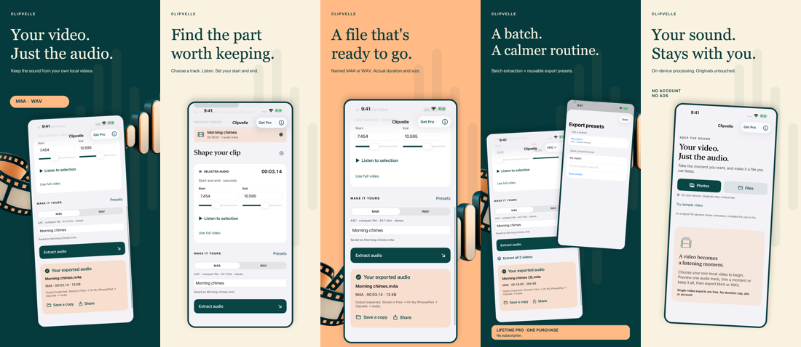
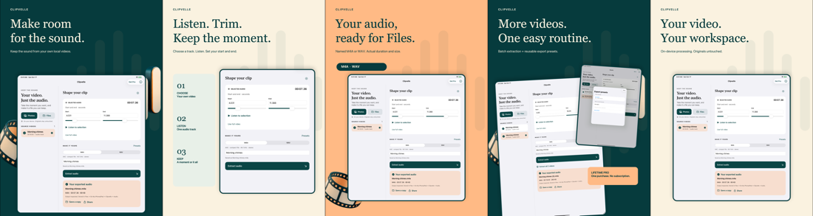

# Clipvelle: Video to Audio

**Your video. Just the audio.** A focused native iPhone and iPad utility that extracts a chosen audio track from your own local video, lets you listen and trim one segment, then exports a named M4A or WAV file.

**Status · October 17, 2026:** Final candidate **1.0 (3)** is Apple-validated, uploaded, processed and selected in App Store Connect. Exact typed trim and iPad focus fixes passed iPad26.2/iOS17 regression checks; final-source iPhone/iPad export, share, relaunch, Photos import, paid batch and presets passed. Premium campaigns use authentic final-source UI. Data Not Collected privacy label is published. Physical build2 exact trim and completed Save passed; final-source physical/Files reopen, human listening and genuine remote sandbox purchase/restore remain open pending device availability and owner authentication. **Not submitted or released.** Commercial source is maintained separately in a private repository.

## Campaign

Distinct iPhone and iPad art direction around authentic final app UI. Original chime media and decorative film-to-sound artwork; no fabricated controls or output data.

[Full iPhone frames](docs/assets/iPhone) · [Full iPad frames](docs/assets/iPad)

## Product

- Photos and Files import; original media remains untouched.
- Explicit selection when a video has multiple audio tracks.
- Preview and inspectable start/end times.
- Compact AAC/M4A and uncompressed PCM/WAV export with actual duration and file size.
- Dedicated iPad source list and inspector.
- Free single-video exports; Lifetime Pro adds batch extraction and reusable export presets. No subscription.

## Engineering

Swift, SwiftUI, AVFoundation, PhotosUI, UniformTypeIdentifiers and StoreKit 2. Universal iPhone/iPad with an iOS 15 deployment target and availability fallbacks. Streaming reader/writer conversion, coordinated security-scoped imports, cancellation cleanup, durable source/export ownership and verified StoreKit entitlements. XCTest covers decoded audio, trimming, invalid media, collisions, cancellation and persistence. No third-party runtime dependencies.

## Privacy

On-device media processing, no account, ads, tracking SDK or media upload service. Local event totals never leave the device. Apple provides purchases; sharing and Files destinations are chosen by the user.

[Privacy](https://sepidehdalir.github.io/clipvelle/privacy.html) · [Support](https://sepidehdalir.github.io/clipvelle/support.html)

Designed and engineered by **Sepideh Javanbakht Dalir** · [arvinify.com](https://www.arvinify.com) · hello@arvinify.com
